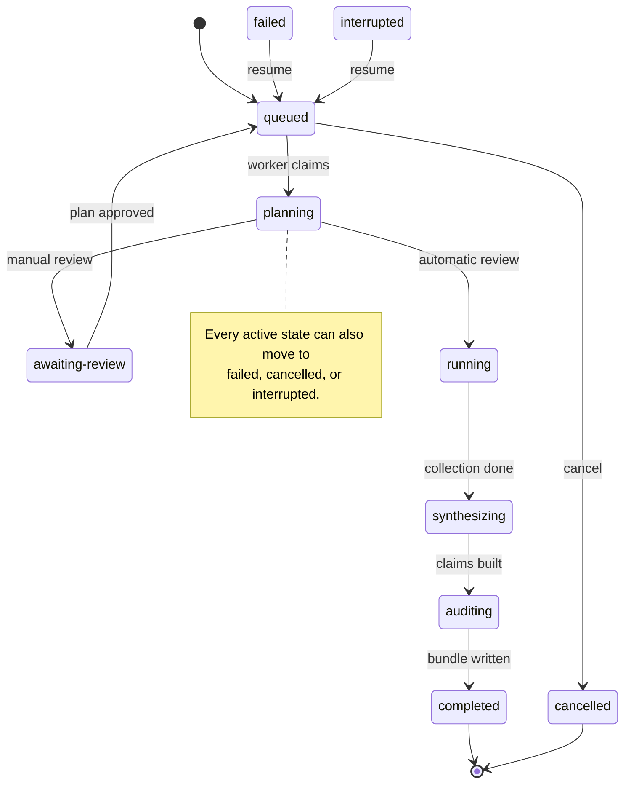

# research-daemon

Rust workspace for the research-station daemon, API, CLI, and MCP surfaces.

Phase 1 is implemented: the Tavily provider layer, rate limiting, budgets,
caching, raw-response storage, and a CLI to exercise them.

Phase 2 is implemented through the working pipeline and daemon: durable jobs,
leases, crash recovery, a deterministic planner/collector/synthesizer/auditor,
and a resumable artifact bundle. `research run` completes a job in-process;
`research serve` and `researchd` process the queue. The HTTP API and MCP server
are the remaining Phase 2 surfaces.

The model-provider foundation and the iterative agent loop are implemented:
`research-llm` talks to an OpenAI-compatible endpoint (OpenCode Go by default),
and `research-agent` runs the budgeted plan → search/extract → synthesize →
audit loop. New jobs use the agent engine by default; the deterministic
pipeline remains available with `--engine deterministic`.

See [`../docs/architecture.md`](../docs/architecture.md) for the full design.

`researchd` is a worker process, not an HTTP daemon. There is no network API
yet: the `research` CLI and `researchd` open the same SQLite database, and the
CLI either enqueues work or claims and runs it in-process. The web/API surface
is still planned.

---

## What the daemon does

The queue holds **research jobs**, not individual search queries. A job is a
whole research question with a depth, domain constraints, budgets, review
policy, and output directory. Query seeds are produced later by the planner.

### 1. Durable queue and lifecycle

`research-store` owns the SQLite-backed queue:

- **Enqueue** with an optional idempotency key; reusing a key returns the
  original job instead of creating a duplicate.
- **Claim** the oldest queued job under a lease, then renew that lease with a
  heartbeat while the pipeline runs.
- **Validate** every status change against the state machine in
  `research-core`; illegal transitions are rejected before SQL is written.
- **Cancel**: queued jobs stop immediately; active jobs get a cooperative flag
  that the worker observes on its next heartbeat.
- **Resume** interrupted or failed jobs without losing attempt history.
- **Approve** a plan that paused for manual review.
- **Reap** expired leases: a dead worker's job becomes `interrupted`, or
  `cancelled` when cancellation was requested before the crash.
- Record every transition in `job_events` for `research job events` and future
  streaming consumers.

### 2. Pipeline orchestration

`research-service` polls the queue and drives each claimed job through either
the agent engine or the deterministic fallback. It also enforces the wall-time
budget, runs the heartbeat task, detects cancellation and lost leases, and
reaps expired leases periodically. One worker process runs one job at a time.

The **agent engine** (`research-agent`) is the default:

- **Plan**: the model returns a schema-validated plan. Invalid output falls
  back to the rule-based planner and records the fallback in the transcript.
- **Per-subquestion loop**: the model chooses one action at a time from
  `search`, `extract`, `read_source`, or `finish`. The daemon executes the
  action through the same provider gateway as the deterministic pipeline.
- **Synthesize**: the model receives only the evidence ledger, with no tools,
  and returns claims that cite source indices and exact quotes.
- **Audit**: every quote is checked against the stored note. Unsupported claims
  are dropped; the extractive synthesizer is the fallback if the model
  produces no auditable claims.
- **Transcript**: every plan prompt, action prompt, model response, tool
  result, budget stop, and run ending is appended to SQLite. Read it with
  `research job transcript <id>`.

The **deterministic fallback** (`research-pipeline`) remains available:

- **Plan**: a rule-based planner. `quick`, `thorough`, and `exhaustive`
  produce 2, 4, and 6 subquestions.
- **Collect**: two query seeds per subquestion, with URL and content-hash
  deduplication.
- **Synthesize**: exact sentences from stored notes become claims.
- **Audit**: exact-substring quote verification.

A failed audit does not fail the job. `run.json` records
`completed-with-audit-findings` while the job still reaches `completed`.

### 3. Provider gateway

`research-provider` is the only code that talks to search vendors:

- `SearchProvider` abstraction with Tavily, a deterministic fake provider, and
  a dispatcher used by the service.
- Token-bucket rate limiting plus a concurrency semaphore.
- Retries with exponential backoff and jitter, `Retry-After` support, and
  Tavily quota/capacity error mapping.
- SQLite query cache keyed by provider, operation, and normalised request.
  Cache hits consume no credits and do not count against the query budget.
- Query and credit budgets reserved and recorded around each request.
- Content-addressed raw-response blobs.
- Credential lookup from the environment, then SecretSpec/keyring.

`extract` exists on the provider trait and in the CLI, but the pipeline
currently collects evidence with `search` plus `include_raw_content`.

### 4. Artifacts and progress

The bundle on disk is the checkpoint. `progress.v1.json` records completed
subquestions, so a resumed job skips work that was already paid for. JSONL
writers tolerate a partial final line after a crash, and bundle writes are
atomic. `run.json` is stamped by the daemon, never by a model.

---

## Job state machine

GitHub renders Mermaid in fenced code blocks, so the diagram is stored as
text and stays reviewable in git.



The happy path is `queued → planning → running → synthesizing → auditing →
completed`. A manual-review job stops at `awaiting-review` until
`research job approve` marks the bundle plan approved and requeues it.

`completed` and `cancelled` are terminal. `failed` and `interrupted` are
deliberately resumable: `research job resume` returns them to `queued`, and the
next worker continues from the bundle checkpoint.

> **Manual-review caveat:** `awaiting-review` is currently treated as an
> active lease state. A review that takes longer than `jobs.lease_seconds`
> can be reaped to `interrupted`. Check or fix this before relying on long
> review windows.

---

## Agent loop and budgets

The agent loop is deliberately bounded. It is not an open-ended "keep
searching until you feel done" process.

```text
plan
  └─ for each subquestion:
       build a compact evidence context
       ask the model for one action
       execute search / extract / read_source
       record the tool result
       stop on finish, budget, or max rounds
  └─ synthesize from the evidence ledger (no tools)
  └─ audit exact quotes
  └─ write the bundle
```

Budgets are checked before each model action and after each tool result:

| Budget | Meaning | Default |
|---|---|---|
| `max_queries` | search/extract provider calls | depth: 12 / 40 / 100 |
| `max_sources` | accepted source records | 60 |
| `max_credits` | provider credits | 100 |
| `max_llm_tokens` | prompt + completion tokens | 200,000 |
| `max_wall_seconds` | wall-clock limit | 900 |
| `max_agent_rounds` | model action turns across the job | 24 |

`max_agent_rounds` is divided across the planned subquestions. For example, a
thorough job with four subquestions gets six action turns per subquestion
(24 / 4). A subquestion ends when the model calls `finish` and at least one
source exists for it, or when a budget or round limit is reached.

Stop reasons are written to `run.json` and the transcript. Common reasons are
`satisfied`, `max_rounds`, `budget_queries`, `budget_sources`,
`budget_credits`, `budget_llm_tokens`, `cancelled`, and `wall_time`.

Transcript storage shares the job SQLite database:

- `agent_runs` — one row per job: engine, model, prompt version, status, stop
  reason, and aggregate usage.
- `agent_events` — append-only rows: `plan_request`, `plan_response`,
  `action_request`, `action_response`, `action`, `tool_result`,
  `finish_attempt`, `synthesis_request`, `synthesis_response`, `run_end`, and
  fallback/error events. Payloads are JSON and contain the full prompt,
  response, action, and tool result.

---

## Layout

```
crates/
  research-core/      domain types, config, errors; no I/O
  research-store/     SQLite query cache, blob store, and durable job queue
  research-provider/  SearchProvider trait, Tavily, fake provider, limiter, budget
  research-llm/       OpenAI-compatible model client, fake model, usage accounting
  research-agent/     budgeted agent loop, prompts, transcript integration
  research-pipeline/  planner, collector, synthesis, audit, bundle writer
  research-service/   runner, worker loop, provider construction
  research-daemon/    `researchd` binary
  research-cli/       `research` binary
```

## Build and test

```bash
cd research-daemon
cargo test --workspace
cargo clippy --workspace --all-targets -- -D warnings
cargo fmt --all -- --check
```

Or from the repository root:

```bash
just check
```

With Nix:

```bash
nix develop
nix build .#research        # result/bin/research and result/bin/researchd
nix flake check
nix run .#research -- run "How do Tavily and Kagi compare?" --fake
```

## Configuration

Copy the example config:

```bash
cp research-daemon/config/researchd.example.toml research-daemon/config/researchd.toml
```

The default search locations are:

1. `--config <path>`
2. `$RESEARCHD_CONFIG`
3. `research-daemon/config/researchd.toml`
4. `$XDG_CONFIG_HOME/research-station/researchd.toml`
5. built-in defaults

The API key is never stored in the config file. It is declared in
`secretspec.toml` at the repository root and resolved by [secretspec], so each
developer chooses where the value lives and nothing secret is committed.

Run these from the repository root:

```bash
secretspec config global init      # once: choose a provider, e.g. the system keyring
just secrets-set                   # prompts for TAVILY_API_KEY
just secrets-set-llm               # prompts for OPENCODE_GO_API_KEY
just secrets-check                 # report what is still missing
just provider test                 # one billed smoke search
```

`secretspec run` injects the variable into the child process. The daemon and
CLI also resolve the key themselves when it is absent from the environment:
they load `secretspec.toml` and ask the configured provider (the system keyring
by default), so `./result/bin/researchd` works without a wrapper. The keyring
provider is compiled into the binary; for other SecretSpec providers, either
export `TAVILY_API_KEY` or keep using `secretspec run`.

Direct binaries find the manifest by searching upward from the working
directory. Set `SECRETSPEC_FILE=/path/to/secretspec.toml` or
`provider.tavily.secretspec_file` in `researchd.toml` when running from
elsewhere, for example under systemd. On Linux the keyring provider needs
gnome-keyring or KWallet running.

Set `TAVILY_TEST_QUERY` to change the query `provider test` uses.

The SQLite database and blob store default to `$XDG_CACHE_HOME/research-station/`.
Jobs and cache metadata share the database; `store.database_path` selects it,
and the older `store.cache_path` remains a fallback.

### Model provider

The model client is OpenAI-compatible and defaults to OpenCode Go:

```toml
[llm]
provider = "opencode-go"
base_url = "https://opencode.ai/inference/go/openai/v1"
model = "deepseek-v4.1-flash"
api_key_env = "OPENCODE_GO_API_KEY"
fallback_api_key_envs = ["OPENCODE_API_KEY"]
# session_id = "my-research-station"
timeout_seconds = 120
max_retries = 3
temperature = 0.2
max_output_tokens = 4096
```

The key is resolved from the primary environment variable, then the fallbacks,
then SecretSpec. It is never written to the config file or a log. `just
secrets-set-llm` stores it in the configured SecretSpec provider; tests and
fake-LLM runs do not need it.

OpenCode Go requires a stable `x-opencode-session` header for routing and
prompt caching. The client generates one per provider instance when
`llm.session_id` is omitted; the agent will set it to the job ID.

[secretspec]: https://secretspec.dev

## CLI

The `just` recipes below additionally wrap commands with secretspec so the
access reason is recorded. The raw `research` binary resolves the key itself
when it is not already in the environment.

```bash
# Show resolved configuration without secrets.
research config show

# Check config, credentials, database, blob store, and model settings.
research doctor

# Also make a minimal model request (fake model needs no key).
research doctor --probe
research doctor --probe --fake-llm

# Run the default agent engine. The deterministic fallback is still available.
research run "How do Tavily and Kagi compare?" --depth quick
research run "How do Tavily and Kagi compare?" --depth quick --engine deterministic

# Credential-free agent loop: fake search provider and fake model.
just agent-demo "How do Tavily and Kagi compare?"

# Inspect the full agent transcript (prompts, responses, tool results).
research job transcript <id>
research job transcript <id> --json

# Verify provider, key, cache, and blob store.
just provider test

# Search.
just search "Tavily vs Kagi for research agents" \
  --depth advanced \
  --max-results 10 \
  --raw-content

# Search with freshness and source constraints.
just search "AI search API pricing" \
  --topic news \
  --time-range month \
  --include-domain tavily.com \
  --include-domain kagi.com \
  --json

# Extract up to 20 URLs.
just extract https://example.com/article --depth advanced
```

`--json` prints the full normalized `ProviderResponse`, including `cache_hit`,
`raw_hash`, `credits`, `request_id`, and `latency_ms`.

## Durable jobs

Phase 2 stores jobs in the same SQLite database as the query cache. A worker
claims the oldest queued job under a lease, heartbeats the lease, and advances
the job through a validated state machine. If the worker dies, the expired
lease is reaped into `interrupted`, and `resume` puts the job back on the queue
without losing its attempt history. Cancellation requested before a crash is
honoured by the reaper instead of being forgotten.

```bash
# Add a job; the output directory defaults to research/<date>-<slug>.
research job enqueue "How do Tavily and Kagi compare?" --depth thorough

# A repeated idempotency key returns the original job.
research job enqueue "ignored" --idempotency-key weekly-pricing

# Inspect.
research job list [--status queued] [--limit 20]
research job show <id>
research job events <id>
research job transcript <id> [--json]

# Control.
research job cancel <id>
research job resume <id>

# A manual-review job pauses after planning.
research job approve <id>

# Wait for a job, then print its report.
research job wait <id>
research job report <id>
```

`research job claim` and `research job reap` are hidden development commands for
exercising a worker without the daemon. The worker calls the same `JobStore`
methods.

## Pipeline and daemon

`research run` enqueues the question, claims that job, and processes it in the
current process. `research serve` (or `researchd`) polls the queue and processes
jobs until interrupted. New jobs use the agent engine by default. `--fake`
selects the deterministic search provider; `--fake-llm` selects the deterministic
model. `--engine deterministic` selects the old rule-based pipeline.

```bash
# From the repository root, without credentials:
just demo "How do Tavily and Kagi compare?"
just agent-demo "How do Tavily and Kagi compare?"

# Real Tavily + OpenCode Go run:
just research "How do Tavily and Kagi compare?" --depth thorough

# Process the queue with the real provider and model, once:
just worker --once

# Long-lived worker with fake provider and fake model:
just worker-fake

# One question, end to end, with fake search and fake model:
research run "How do Tavily and Kagi compare?" --depth thorough --fake --fake-llm

# Deterministic fallback, no model:
research run "How do Tavily and Kagi compare?" --depth thorough --fake --engine deterministic

# Process the current queue once.
research serve --once --fake --fake-llm

# Run the long-lived worker.
researchd --fake --fake-llm
# or
research serve --fake --fake-llm
```

The default agent loop:

1. **Plan** — the model writes `plan.v1.json` and `plan.v1.md`; invalid output
   falls back to the rule-based planner.
2. **Iterate per subquestion** — the model chooses `search`, `extract`,
   `read_source`, or `finish`. The daemon executes the action, writes
   `queries.jsonl`, `sources.jsonl`, and `notes/<source-id>.md`, and records the
   full turn in the SQLite transcript.
3. **Synthesize** — the model receives only the evidence ledger, with no tools,
   and returns claims with exact quotes.
4. **Audit** — every quote must be an exact substring of its stored note.
5. **Deliver** — `report.md`, `audit.md`, `run.json`, and an `INDEX.md` row.

The deterministic fallback is still available for reproducible, model-free
runs: a rule-based planner, two query seeds per subquestion, extractive claims,
and the same exact-quote audit.

A job directory contains:

```
brief.md          original request and budgets
plan.v1.json/md   immutable, versioned plan
queries.jsonl     every provider call and its cost
sources.jsonl     accepted sources and quality metadata
notes/            exact stored text, one file per source
progress.v1.json  completed subquestions and plan approval
report.md         cited report
audit.md          quote verification and coverage
run.json          provider, versions, timestamps, usage, audit result
```

Agent transcripts live in the shared SQLite database (`agent_runs` and
`agent_events`), not in the bundle. `research job transcript <id>` prints the
full prompts, model responses, actions, and tool results.

Progress is persisted after each subquestion. If the worker dies, the expired
lease becomes `interrupted`; `research job resume <id>` requeues it, and the
next worker skips completed subquestions instead of paying for them again.

## Provider behaviour

- **Rate limiting:** token bucket (`requests_per_minute`, `burst`) plus a
  concurrency semaphore (`max_concurrency`).
- **Retries:** 429, 5xx, and capacity-exceeded responses retry with exponential
  backoff and jitter; `Retry-After` is honoured.
- **Quota errors:** Tavily `432`/`433` become `QuotaExceeded`; `434` becomes
  `CapacityExceeded`.
- **Cache:** successful responses are cached by a hash of provider, operation,
  and normalized request. Cache hits cost no credits and do not consume the
  query budget.
- **Budget:** query slots are reserved before a request; failed sends refund the
  slot. Credits are recorded from Tavily's `usage.credits`, falling back to the
  documented estimate.
- **Raw responses:** every successful HTTP body is stored in a content-addressed
  blob store and its hash is returned in the response.

## What is not implemented yet

These gaps matter when adding clients or a web interface:

- **No HTTP API and no Axum server.** The `/v1` routes described in the
  architecture are still planned; `research-api` is not a crate in this
  workspace.
- **No MCP adapter.** `research-mcp` is also still planned.
- **No SSE or event streaming.** `research job wait` polls SQLite once per
  second; a web client needs polling, SSE, or WebSocket support.
- **No authentication or bearer-token handling.**
- **No web rendering.** The daemon writes Markdown and JSON. It does not
  render HTML, serve assets, or convert Markdown to HTML.
- **No multi-job concurrency in one process.** `jobs.max_concurrent_jobs`
  exists in configuration but is not enforced; the worker processes one job at
  a time.
- **No transcript viewer in the web UI yet.** The complete agent transcript is
  in SQLite and available through `research job transcript`; a web surface will
  read the same tables later.

## Notes

- Tavily's `/search` accepts `max_results` 1–20; `/extract` accepts 1–20 URLs.
- `advanced` search costs 2 credits; `basic`, `fast`, and `ultra-fast` cost 1.
- `advanced` extract costs 2 credits per 5 successful URLs; `basic` costs 1.
- Set `cache_ttl_seconds = 0` in the config to effectively disable caching.
